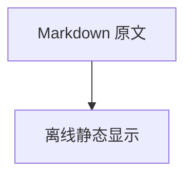
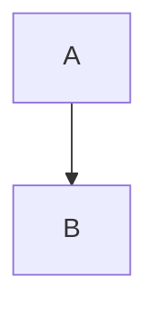

# 降级与安全验收

front matter 应作为静态原文保留并提示。

<iframe src="https://example.invalid/tracker"></iframe>

嵌入 HTML 保留为静态文本

[危险链接](javascript:alert%281%29)

[文件链接](file:///C:/private.txt)

[内部锚点](#不存在的标题)

## 图片预检

这些图片必须产生预检；默认不能继续到保存。明确选择占位后保留图片说明，不读取远程/越界资源。

## 超宽表格

| 一 | 二 | 三 | 四 | 五 | 六 | 七 | 八 | 九 |
| --- | --- | --- | --- | --- | --- | --- | --- | --- |
| 中文长文本待人工检查 | 2 | 3 | 4 | 5 | 6 | 7 | 8 | 9 |

## 扩展的导出差异

以下公式和流程图在预览、HTML 与打印中静态显示。DOCX 输出可编辑源码并提示降级；关闭渲染开关时，HTML 与打印也保留源码。

$$
E = mc^2
$$

下列配置和点击指令不执行，图表回退为完整源码并说明原因：

危险公式命令也保留源码：$\href{https://example.invalid/tracker}{不执行}$。

[unused]: https://example.com/unused "未引用定义应静态保留并提示"

结束：取消、生成失败或原生另存取消都必须保留原 Markdown。
