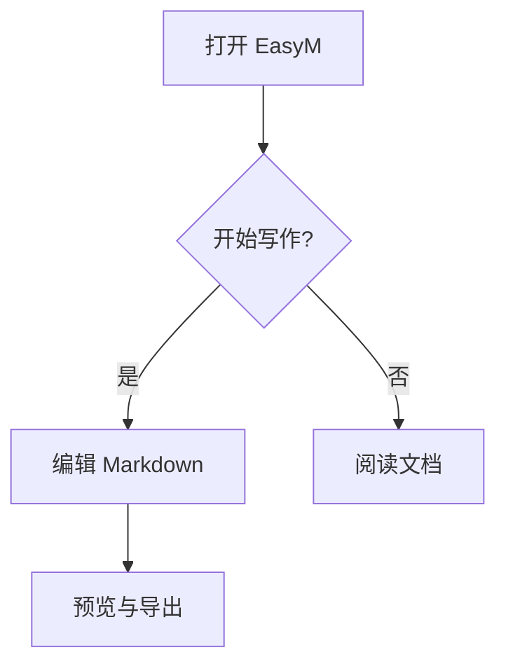
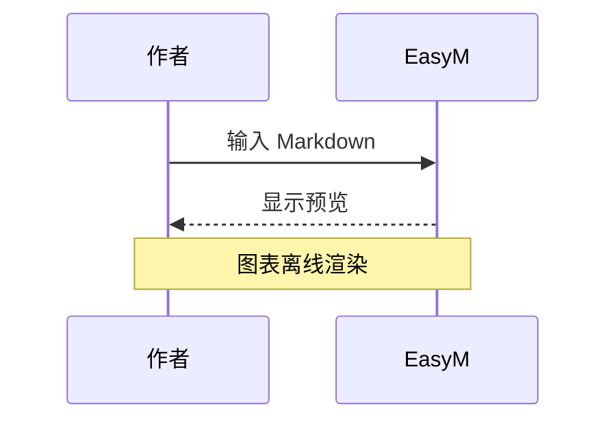
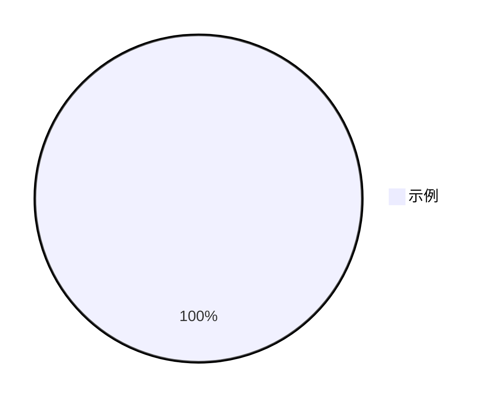

# Mermaid 离线图表

## 流程图



## 时序图



## 错误时保留源码

```mermaid
flowchart TD
    A[未闭合
```

## 其他类型保留源码



设置 → Markdown 扩展 → Mermaid 图表渲染，可独立关闭。HTML 与打印包含静态图；DOCX 提示并保留完整可编辑围栏源码。图表不支持交互、配置指令与外部资源；样式仅支持单独成行的 style/classDef 颜色与数值（fill、color、stroke、stroke-width、stroke-dasharray、font-weight、opacity）。
