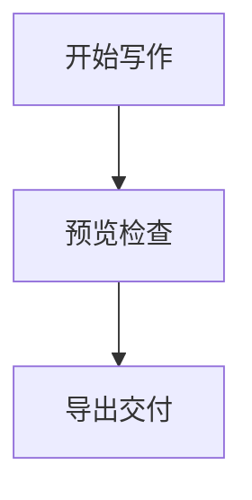
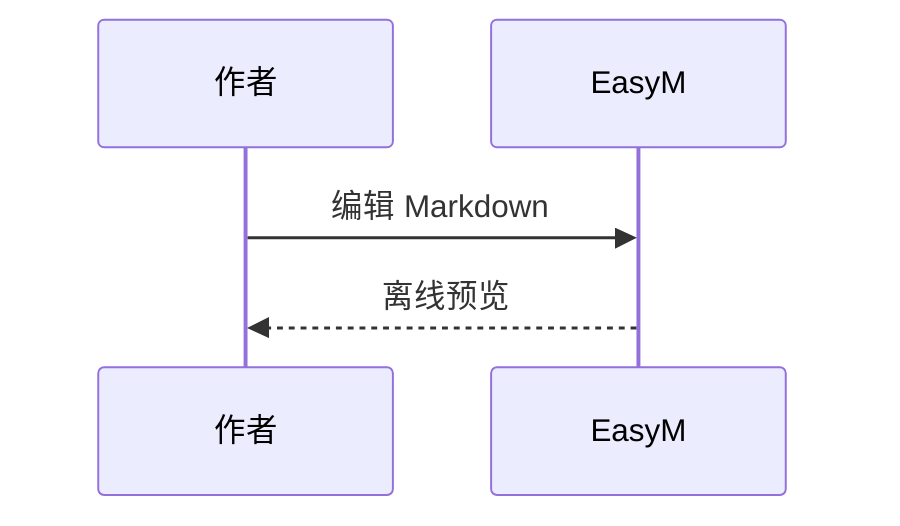
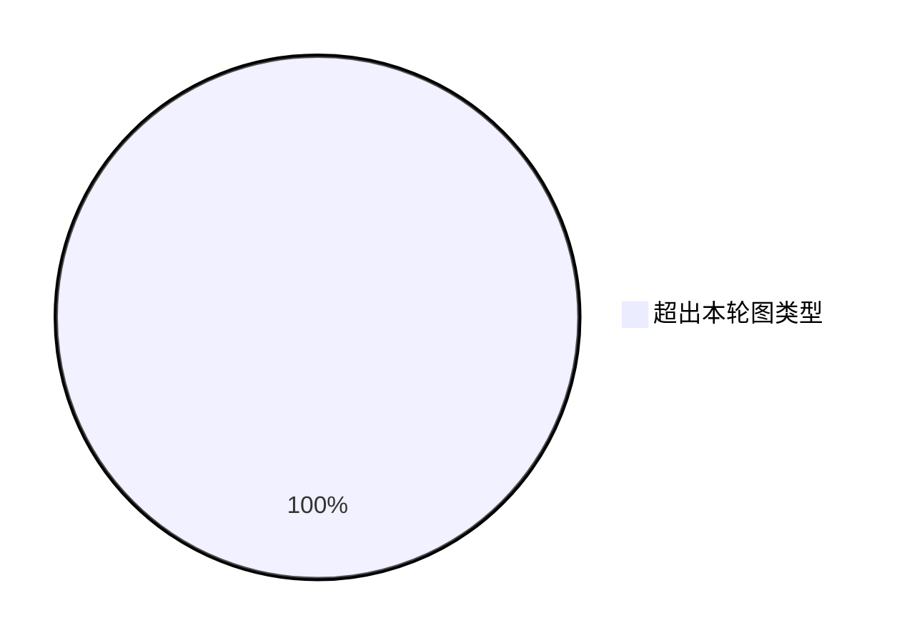

# EasyM v1.0 扩展与导出

同一份 Markdown 混合脚注、公式、图表、表格与本地图片。导出不修改原文。首次引用[^说明]，再次引用[^说明]。

## 数学公式

行内公式 $E=mc^2$，普通价格 $20 不应变成公式。

$$
\frac{1}{2}+\sqrt{4}=\frac{5}{2}
$$

## 流程图

## 时序图

## 表格与图片

| 内容 | HTML / 系统打印 | DOCX |
| --- | --- | --- |
| 脚注 | 文末说明与内部导航 | 文末脚注 |
| 公式 | 静态 MathML | 可编辑 LaTeX 源码 |
| Mermaid | 静态图与源码 | 可编辑围栏源码 |

[^说明]: 这是文末脚注，包含公式 $a^2+b^2=c^2$。DOCX 不使用 Word 原生逐页脚注。

## 可恢复的错误

错误公式 $\unknown{x}$ 保留原文和提示；其他内容仍然可用。

EM → 设置可分别关闭公式或图表渲染。关闭后预览、HTML 与打印保留源码；DOCX 始终保留公式与图表源码。
